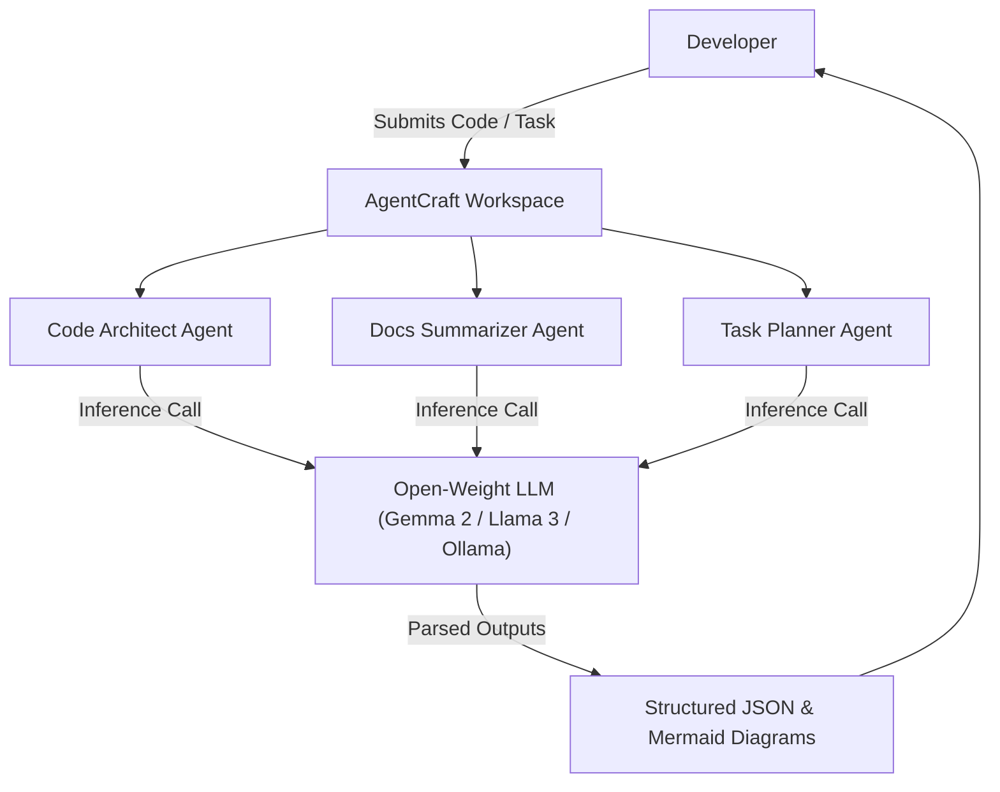

# 🤖 AgentCraft AI

> An open-source multi-agent workspace built for developers, powered by open-weight AI models (Gemma 2, Llama 3, Ollama, Hugging Face).

Built for the **Hacktoberfest 2026 Open-Source AI Challenge: Week 1**.

---

## 🌟 Overview

**AgentCraft AI** is a lightweight, open-source multi-agent framework that orchestrates specialized AI agents locally on private infrastructure without third-party vendor lock-in.

### Specialized Agents:
1. 🏗️ **Code Architect Agent**: Analyzes code structure, generates docstrings, and audits for security/performance best practices.
2. 📑 **Docs Summarizer Agent**: Synthesizes lengthy technical papers and API docs into executive takeaways.
3. 🎯 **Task Planner Agent**: Breaks down project goals into actionable implementation steps and outputs Mermaid workflow diagrams.

---

## 🏗️ Architecture



---

## 🚀 Quick Start

### Prerequisites
- Python 3.9+

### Run Locally

```bash
git clone https://github.com/samainakhatun115-cpu/agentcraft-ai.git
cd agentcraft-ai
py -3 app.py
```

---

## 📜 License

Distributed under the [MIT License](LICENSE).
